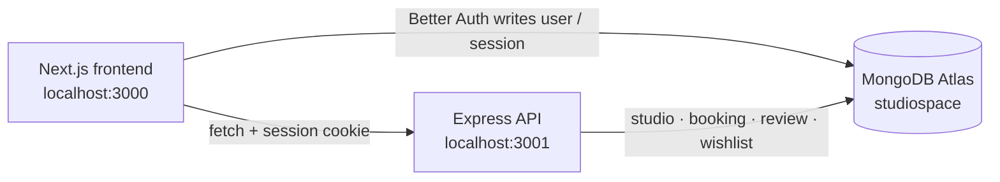

# StudioSpace API


A REST API for discovering and booking creative studio spaces — photo lofts, film
stages, podcast booths, music rooms, and workshops. StudioSpace powers studio
listings, real-time availability, bookings, reviews, wishlists, and host
dashboards, and shares its authentication with the Next.js frontend.

> **Live API:** https://assignment-08-backend-pi.vercel.app



---

## Overview

StudioSpace is split into two sibling apps that share one MongoDB database.
The Next.js frontend owns authentication through Better Auth; this Express API
owns the marketplace domain — studios, bookings, reviews, wishlists, and
newsletter subscribers. Because cookies are scoped by domain (not port), the
frontend's session cookie is also accepted by the API, so users sign in once
and stay signed in across both apps.

## Technologies Used

| Layer | Technology |
|---|---|
| Runtime | Node.js 20+ with native ES modules |
| Framework | Express 5 |
| Database | MongoDB Atlas with the native `mongodb` driver v7 |
| Authentication | Better Auth session cookies (issued by the Next.js app) |
| File uploads | imgbb API (server-side proxy) |
| Deployment | Vercel serverless functions |
| Tooling | dotenv, CORS, nodemon |

## Key Features

### 1. Studio discovery with filtering, sorting, and pagination
`GET /api/studios` supports full-text search, category/location filters, price
ranges, amenity matching, five sort modes, and paged results. Hosts can create,
edit, and delete their own listings, with slugs generated automatically and kept
unique.

### 2. Conflict-free availability and bookings
Availability is checked per calendar day, and the server re-validates every
booking for overlapping hours before inserting it (`409` on a race). Minimum
booking hours, studio pricing, and the final total (`hours × price + deposit`)
are all enforced server-side, so clients can never submit a stale or tampered
total.

### 3. One login shared across both apps
The API validates the `better-auth.session_token` cookie directly against Better
Auth's `session` collection — no shared secret, no second login, and no auth
endpoints in this service. `requireUser` attaches the member to each request, and
ownership checks keep host-only actions safe.

### 4. Verified reviews and live ratings
Only members with a completed booking can review a studio, and each member may
review a studio once. Ratings and review counts are aggregated into the studio
document, so public listings stay in sync with real feedback.

### 5. Host dashboards, wishlists, and supporting flows
Hosts get their own listings and booking stats; members can save studios to a
wishlist, download booking receipts, update their profile and avatar, subscribe
to the newsletter, and upload images through a proxied imgbb integration.

---

## Quick Start

### Prerequisites

- Node.js 20 or newer
- A MongoDB Atlas connection string
- The sibling frontend checkout at `../studiospace_front_end` (required for
  seeding the catalog)

### Install and configure

```bash
npm install
```

Create `.env` in this directory:

```ini
PORT=3001
MONGODB_URI=mongodb://<user>:<pass>@<host>/studiospace
DB_NAME=studiospace
CORS_ORIGIN=http://localhost:3000
IMGBB_API_KEY=
```

- Use the **non-SRV** `mongodb://` URI locally; `mongodb+srv://` can fail with
  `querySrv ECONNREFUSED`.
- `CORS_ORIGIN` must match the browser origin exactly, including the port.
- `IMGBB_API_KEY` is optional and only needed for `POST /api/uploads`.

### Seed the database

```bash
npm run seed        # catalog studios + sample reviews
npm run seed:demo   # catalog + demo accounts, listings, bookings, reviews, wishlist
```

Both seeds are idempotent and write to the database in `MONGODB_URI`. The catalog
is imported from `../studiospace_front_end/src/lib/studios.js`.

<details>
<summary><strong>Demo accounts</strong> (password: <code>Studio123</code>)</summary>

| Account | Role |
|---|---|
| `host@studiospace.dev` | Owns 4 listings; incoming bookings in every state |
| `customer@studiospace.dev` | 4 bookings and 3 saved studios |
| `maya@studiospace.dev` | Completed Blue Note booking, ready to review |

</details>

### Run and verify

```bash
npm run dev     # nodemon on http://localhost:3001
npm start       # plain Node for production
```

| Check | Command | Expected |
|---|---|---|
| Health | `curl http://localhost:3001/api/health` | `{"ok":true,...}` |
| Database | `curl http://localhost:3001/api/health/db` | `{"ok":true,"database":"studiospace"}` |
| Public data | `curl "http://localhost:3001/api/studios?limit=3"` | `total: 8` |
| Auth guard | `curl http://localhost:3001/api/wishlist` | `401` |

There are no test, lint, or typecheck scripts — the checks above are the
verification path.

## API Overview

Base URL: `http://localhost:3001`

| Method | Endpoint | Access |
|---|---|---|
| `GET` | `/api/health`, `/api/health/db` | Public |
| `GET` | `/api/studios`, `/api/studios/:idOrSlug` | Public |
| `GET` | `/api/studios/:idOrSlug/availability`, `/reviews` | Public |
| `POST` | `/api/studios`, `/api/studios/:idOrSlug/reviews` | Authenticated |
| `PATCH` / `DELETE` | `/api/studios/:idOrSlug` | Owner |
| `GET` / `POST` | `/api/bookings` | Authenticated |
| `PATCH` | `/api/bookings/:id` | Creator or host |
| `GET` | `/api/bookings/:id/receipt` | Creator or host |
| `GET` / `POST` / `DELETE` | `/api/wishlist`, `/api/wishlist/:studioId` | Authenticated |
| `GET` | `/api/host/listings`, `/api/host/stats` | Authenticated |
| `PATCH` | `/api/users/me` | Authenticated |
| `POST` | `/api/uploads` (needs imgbb key), `/api/newsletter` | Auth / public |

All errors use a consistent shape: `{ "error": "message" }`.

## Project Structure

```
.
├── api/index.js          # Vercel serverless entry
├── index.js              # Local long-running server entry
├── src/
│   ├── app.js            # Express app, CORS, routes, error handler
│   ├── auth.js           # Better Auth session validation
│   ├── db.js             # MongoDB connection + indexes
│   ├── errors.js         # ApiError helpers
│   ├── validate.js       # Shared validation and formatting
│   ├── seed.js           # Catalog seed
│   ├── seed-demo.js      # Demo data seed
│   └── routes/           # studios, bookings, wishlist, host, users, uploads, newsletter
├── docs/SETUP.md         # Full setup, frontend wiring, and deployment guide
└── vercel.json           # Rewrites all requests to the serverless function
```

## Deployment

The API is deployed as a Vercel serverless function:

- **Entrypoint:** `api/index.js` exports the Express app from `src/app.js`
- **Routing:** `vercel.json` rewrites every request to `/api`
- **Environment:** set `MONGODB_URI`, `DB_NAME`, `CORS_ORIGIN`, and optionally
  `IMGBB_API_KEY` in the Vercel project — do **not** set `PORT`
- **Health checks:** `/api/health` never touches the database; `/api/health/db`
  reports Atlas connectivity (`503` when unreachable)
- **Body limit:** Vercel caps request bodies at 4.5 MB, even though Express is
  configured for 40 MB

The frontend proxies browser requests through `/api/proxy/*` so the Better Auth
cookie works across the two `*.vercel.app` domains.

## Documentation

See [`docs/SETUP.md`](docs/SETUP.md) for the complete guide: local setup,
frontend endpoint wiring, how the shared session works, an end-to-end smoke
test, troubleshooting, and deployment steps.

## License

ISC © Rehat
